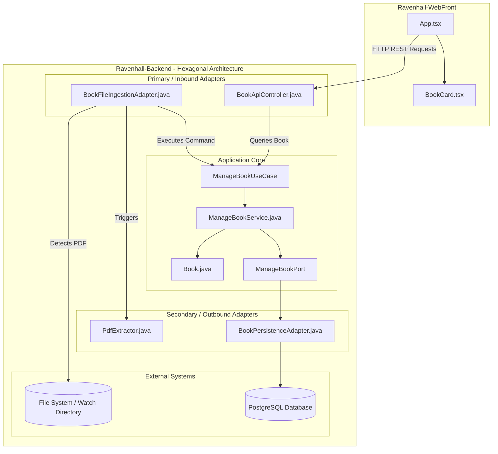

# 🏯 Ravenhall: Media Sync Library Management System

Welcome to **Ravenhall**, a modern, full-stack Media Sync Library Management System designed to catalog, monitor, and synchronize digital books and manga. 

Ravenhall consists of two main applications working in tandem:
1. **`Ravenhall-Backend`**: A robust Spring Boot application engineered using **Hexagonal Architecture (Ports and Adapters)**. It continuously monitors a file directory, auto-ingests new PDF materials, extracts metadata, and persists book registries to a PostgreSQL database.
2. **`Ravenhall-WebFront`**: A premium, responsive single-page React client styled with **Tailwind CSS v4** and built on **Vite 8** and **TypeScript**, which showcases the cataloged libraries dynamically.

---

## 📐 System Architecture

Ravenhall utilizes Hexagonal Architecture on the backend to enforce a strict separation of concerns, ensuring core domain logic is independent of external frameworks, libraries, databases, and UI choices.



---

## 🛠️ Tech Stack & Dependencies

### Frontend (`Ravenhall-WebFront`)
*   **Framework:** React 19 (Functional Components & Hooks)
*   **Build Tool:** Vite 8 + TypeScript + ESLint
*   **Styling:** Tailwind CSS v4 (native stylesheet directives)
*   **API Client:** Native Fetch API with state hooks

### Backend (`Ravenhall-Backend`)
*   **Runtime:** Java 21 (JDK 21)
*   **Framework:** Spring Boot 4.1.0 (Web MVC, Data JPA, Security)
*   **Integration:** Spring Integration (File module) for watching directory nodes
*   **Document Processing:** Apache PDFBox 3.0.7 (metadata, checksum, and file metrics extraction)
*   **Database & Migration:** PostgreSQL, Flyway, Hibernate
*   **Mappers & Helpers:** MapStruct 1.6.3, Lombok 1.18.x

---

## 🚀 Setting Up & Running

### 1. Prerequisites
Ensure you have the following installed on your machine:
*   Java Development Kit (JDK) 21 or higher
*   Maven 3.8+
*   Node.js (v18+) and npm
*   PostgreSQL running locally or on a server

---

### 2. Running the Backend (`Ravenhall-Backend`)

1.  **Configure Database Connections:**
    Open `application.properties` and update the datasource parameters:
    ```properties
    spring.datasource.url=jdbc:postgresql://localhost:5432/your_database
    spring.datasource.username=your_username
    spring.datasource.password=your_password
    ```
2.  **Configure Ingestion Watch Target:**
    Adjust `directory.books` to the path of the directory you wish to monitor:
    ```properties
    directory.books=/path/to/your/watch/directory
    ```
3.  **Run the Spring Application:**
    Navigate to the backend directory and launch via Maven wrapper:
    ```bash
    ./mvnw spring-boot:run
    ```
    The server will boot up and bind to port **`8081`** by default.

---

### 3. Running the Frontend (`Ravenhall-WebFront`)

1.  **Install Dependencies:**
    Navigate to the frontend folder and run:
    ```bash
    npm install
    ```
2.  **Start Development Server:**
    Run the dev server:
    ```bash
    npm run dev
    ```
    The application will compile and become available on the local interface (usually `http://localhost:5173`).
3.  **Verify Flow:**
    *   Drop a PDF book file into the monitored folder.
    *   Verify the backend parses metadata, persists details, and that the frontend updates its display.

---

## 🔗 Key Source Files Referencing

### Backend Codebase
*   **Main Application Root:** [RavenhallApplication.java](../Ravenhall-Backend/src/main/java/dev/ravenhall/RavenhallApplication.java)
*   **REST Endpoint Adapter:** [BookApiController.java](../Ravenhall-Backend/src/main/java/dev/ravenhall/book/adapters/in/web/BookApiController.java)
*   **Automatic PDF Watch Ingestor:** [BookFileIngestionAdapter.java](../Ravenhall-Backend/src/main/java/dev/ravenhall/book/adapters/in/file/filewatcher/BookFileIngestionAdapter.java)
*   **Core Domain Model:** [Book.java](../Ravenhall-Backend/src/main/java/dev/ravenhall/book/domain/Book.java)

### Frontend Codebase
*   **Client Core Logic:** [App.tsx](./src/App.tsx)
*   **Presentation Component:** [BookCard.tsx](./src/components/BookCard.tsx)
